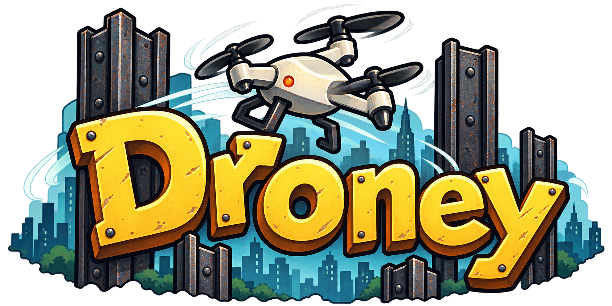

# Blake Swing

**Gameplay Programmer | C++ · C# · Lua | Unreal Engine · Unity**

I build gameplay systems, playable prototypes, and tools for creating game worlds. My work spans combat and interaction mechanics, terrain authoring inside Unreal Engine, and gameplay programming and reverse engineering for SWGEmu.

I'm seeking **Gameplay Programmer** and **Gameplay Programmer Intern** opportunities.

[itch.io](https://phoenixdevelopment.itch.io/) · [Resume (PDF)](assets/Blake_Swing_Gameplay_Programmer_Resume.pdf) · [Email](mailto:blake.a.swing@gmail.com)

## Selected work

| Project | My role | Focus | Explore |
| --- | --- | --- | --- |
| **Brushfire** | Sole programmer | Combat and painting systems; IndieCade Climate Jam 2025 | [Game page and demo](https://zygarde824.itch.io/brushfire) |
| **Veltino Grove** | Sole programmer | NPC interaction, cooking, ingredient collection, and karma | [Game page and build](https://hlim951.itch.io/veltino-grove) |
| **Terra Forge** | Independent developer | Terrain and world authoring inside Unreal Engine 5 | [Features and preview](#terra-forge) |
| **SWGEmu** | Gameplay programmer / reverse engineering contributor | Shared spatial partitioning architecture for ground and space zones | [Technical overview](#swgemu) |
| **Droney** | Independent developer | Arcade gameplay and layered parallax in Unity | [Project overview](#droney) |

## Brushfire

**Unreal Engine · Game jam team project · 2025**

Brushfire is an action-adventure game about protecting and restoring a forest. Players switch between fighting fire-based enemies and using a painting mechanic to repair the environment.

[▶ Watch Brushfire gameplay on YouTube](https://www.youtube.com/watch?v=cG6dYBwjEoI)

**My contribution**

- Served as the sole programmer within a 12-person development team.
- Implemented the combat and painting systems for the playable demo.

**Problem and solution - Painting that affects the world**

The painting mechanic needed to place paint on terrain and trigger interactions based on where and what the player painted. I implemented a trace-and-decal system to project paint onto the ground, then used the paint type and target area to determine which item to spawn.

**Team result:** Placed **6th overall out of 33 entries** in IndieCade Climate Jam 2025.

[Game page and demo](https://zygarde824.itch.io/brushfire) · [Jam results](https://itch.io/jam/climate-jam-2025/rate/3673860)

## Veltino Grove

**Unreal Engine · C++ / Blueprints · Game jam team project · 2024**

Veltino Grove is a 3D cooking adventure about reviving a dying forest. Players explore, gather ingredients, interact with characters, and run a restaurant. A karma system connects their resource-gathering choices to the state of the environment.

**My contribution**

- Served as the sole programmer on the game jam team.
- Built the NPC interaction, ingredient collection, cooking, and karma systems.
- Created configurable spawning tools for the level-design team.

**Problem and solution - Configurable spawning for level designers**

The game needed to spawn and despawn objects in response to player activity, while giving level designers a practical way to configure them. I built a custom spawning system using data assets and a reusable Blueprint object that designers could place in the level.

*Editor setup: the custom spawner exposes spawnable content for level designers.*

*Runtime result: objects created by the spawner after the game starts.*

[Game page, build, and design documents](https://hlim951.itch.io/veltino-grove)

## Terra Forge

**Unreal Engine 5 · C++ · Independent project · 2026**

Terra Forge is an Unreal Engine plugin for creating and adjusting terrain, water, regions, and materials within the editor.

**Problem and solution - Terrain authoring inside the editor**

Moving between Unreal Engine and external terrain tools can interrupt world-building iteration. I developed Terra Forge to bring terrain creation, live previews, and adjustments into the editor before committing changes to the level.

**Working features**

- Terrain feature creation and editing with a live preview.
- Water and region authoring within the same tool.
- Texture changes driven by height or regions.

**Development approach:** Built independently using AI-assisted coding and prompt engineering alongside my Unreal Engine knowledge.

The preview below shows the authoring interface with a world-size setting of **150 km**.

*Development screenshot showing terrain features, region and material tools, and the world preview.*

## SWGEmu

**C++ · Lua · Gameplay systems · Reverse engineering**

I contributed gameplay programming and reverse engineering work to SWGEmu, including its initial octree implementation for Jump to Lightspeed space zones.

**My contribution**

- Implemented octree support for space zones and updated dependent systems throughout the codebase.
- Contributed gameplay, networking, and scripting fixes in C++ and Lua.

**Problem and solution - Supporting ground and space zones**

The existing spatial architecture depended on quadtrees for ground zones. Space zones required three-dimensional partitioning without disrupting ground-zone behavior. I refactored the architecture around a shared `Tree` base type, with separate quadtree and octree implementations for ground and space. This involved tracing dependencies throughout the codebase and checking affected systems after the refactor.

**Outcome:** A shared spatial architecture supporting both ground and space zones.

[SWGEmu Core3](https://github.com/TheAnswer/Core3)

## Droney

**Unity · C# · Independent project**

Droney is a Flappy Bird–inspired arcade game that challenges players to navigate a drone through narrow gaps between obstacles above a scrolling city skyline.

**My contribution**

- Independently developed the game in Unity using C#.

**Problem and solution - Depth in a scrolling background**

The city backdrop needed a sense of depth as the drone moved through the course. I built a layered parallax system that updates image offsets at adjustable speeds, using `Time.deltaTime` to keep scrolling consistent across frame rates.

## Additional projects

These smaller projects include solo coursework, experiments, and development tools. Links labeled **project notes** lead to repository documentation.

| Project | Focus | Link |
| --- | --- | --- |
| **Class2024InkleProject** | Solo interactive-fiction prototype exploring functions in a standalone Inkle project | [Play in browser](https://phoenixdevelopment.itch.io/inkieadventure) |
| **Run and Gun** | Unreal Engine coursework project | [Project notes](https://github.com/Sphinksz/Swing-G300-Week7) |
| **3D Platformer** | Unreal Engine 5.4.4 coursework project with directional coin interactions | [Project notes](https://github.com/Sphinksz/Swing-G300-Week6) |

## Technical skills

- **Languages:** C++, C#, Lua, Python, C, Java, JavaScript.
- **Engines and tools:** Unreal Engine 5, Unity, Git, GitHub, Visual Studio, JetBrains Rider, Inkle.
- **Areas of work:** Gameplay mechanics, AI behaviors, user interfaces, multiplayer networking, spatial partitioning, scripting, debugging, and reverse engineering.

## Background and contact

I'm studying Computer Science and Game Development at **Indiana University Bloomington from 2023 to 2029**. I also served as a **U.S. Army Explosive Ordnance Disposal (EOD) team leader**, leading a two-person team where technical care, coordination, and clear communication were essential.

For gameplay programming opportunities, contact **[blake.a.swing@gmail.com](mailto:blake.a.swing@gmail.com)**.
